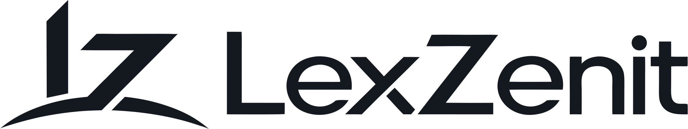
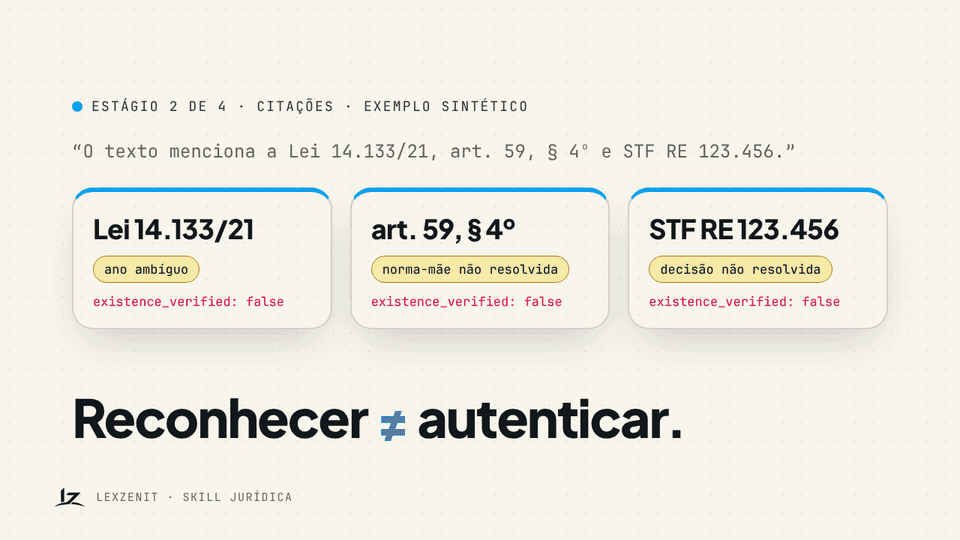
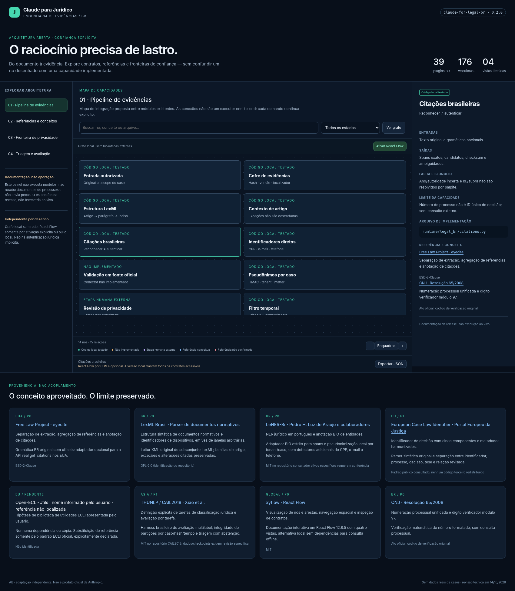

<p align="center">
  <picture>
    <source media="(prefers-color-scheme: dark)" srcset="lexzenit/brand/lockup-white-2048.png">
    
  </picture>
</p>

# LexZenit · skill jurídica para o Claude

Uma solução **AB ED&IA Soluções em Tecnologia Ltda.** (CNPJ 57.531.384/0001-96).

Raciocínio jurídico com lastro, do documento à evidência. 39 plugins, 176 workflows de Direito brasileiro e um núcleo local que guarda o original, reconhece citações sem autenticá-las por palpite, pseudonimiza e para na revisão humana.



## Instalar a partir deste repositório

No Claude Code:

```text
/plugin marketplace add oalexandrebelo/LexZenit-JUD-for-legal-BR
/plugin install br-legal-engineering@legal-br
```

Troque `br-legal-engineering` por qualquer uma das 39 áreas do marketplace `legal-br`. A instalação pelo marketplace ainda não foi homologada no cliente Claude nesta release.

CLI local (Python 3.11 ou superior):

```bash
git clone https://github.com/oalexandrebelo/LexZenit-JUD-for-legal-BR.git
cd LexZenit-JUD-for-legal-BR/runtime
python -m legal_br.engine citations --file examples/engineering/citations.txt
```

## Materiais

| O quê | Onde |
|---|---|
| Landing page (abre offline no navegador) | [`lexzenit/site/index.html`](lexzenit/site/index.html) |
| Apresentação (PowerPoint, 15 slides) | [`lexzenit/media/lexzenit-juridico.pptx`](lexzenit/media/lexzenit-juridico.pptx) |
| Vídeo explicativo (GIF e MP4) | [`lexzenit/media/`](lexzenit/media/) |
| Marca (SVG e PNG, tinta e branco) | [`lexzenit/brand/`](lexzenit/brand/) |

A pasta `lexzenit/` não faz parte do pacote 0.2.0 e não entra em `MANIFEST.sha256`.

---

## Pacote: Claude para Jurídico

**`claude-for-legal-br` · versão 0.2.0 · adaptação independente para o Brasil.**

39 plugins, 176 workflows e núcleo local de evidências. Esta release adiciona engenharia original de citações, estrutura LexML, pseudonimização e avaliação de triagem, com documentação interativa em React Flow e modo offline. Não é uma edição oficial da Anthropic, não cobre todo o Direito brasileiro de forma homologada e não substitui revisão profissional.



## Começar

Abra **[a arquitetura interativa](apps/architecture/index.html)**; leia o **[estudo de oportunidades](research/OPORTUNIDADES.md)** e os **[contratos da versão](docs/ENGINEERING-V02.md)**. A arquitetura distingue código implementado, integração opcional, etapa humana e capacidade pendente.

A camada preserva os 38 plugins e 169 workflows da 0.1.0, acrescentando `br-legal-engineering` com sete workflows. O [catálogo completo](docs/COVERAGE.md) é verificável no JSON `catalog/skills.json`. Workflows são instruções para análise, não 176 modelos ou integrações externas prontas.

## Conceito aproveitado e implementação

| Referência | Aproveitamento | Estado |
|---|---|---|
| Free Law Project / eyecite | Extração separada de resolução e validação; gramática BR própria | Código BR testado; adaptador US opcional não executado |
| LexML Parser / padrão LexML | Hierarquia de dispositivos e preservação de exceções | Leitor XML próprio de subconjunto; sem código GPL copiado |
| LeNER-Br | BIO e NER jurídico em português | Adaptador e pseudonimização; sem checkpoint neural |
| ECLI oficial | Identidade de decisão e metadados | Sintaxe; sem autenticação do registro ou força jurídica |
| Open-ECLI-Utils | Referência sugerida pelo usuário | Não identificada com confiança; nenhuma dependência criada |
| THUNLP / CAIL | Tarefas de classificação e avaliação | Métricas e partições; sem modelo treinado ou rótulos estrangeiros |

Autoria, links primários, licenças e limites: [registro de referências](research/references.json). Não foram redistribuídos corpus jurídicos, pesos ou textos de normas técnicas licenciadas.

## CLI local

Com Python 3.11 ou superior, a partir de `runtime/`:

```bash
python -m legal_br.engine citations --file examples/engineering/citations.txt
python -m legal_br.engine lexml --file examples/engineering/norma-sintetica.xml
python -m legal_br.engine ecli ECLI:EU:C:2020:559
python -m legal_br.engine evaluate --file examples/engineering/evaluation.json
python -m legal_br.engine validate-split --file examples/engineering/splits.json --cutoff 2025-12-31
python -m legal_br.engine triage --file examples/engineering/scores.json
```

Os quatro módulos novos são locais e não exigem LLM, GPU, clone de repositório, API oficial ou banco vetorial. Os exemplos são sintéticos. Um identificador de aparência real é entrada de parsing, não confirmação do precedente.

Para pseudonimização, use chave criptográfica própria em arquivo privado fora do repositório. O CLI nunca fornece uma chave de produção de exemplo e não autoriza egress. Veja `QUICKSTART.md` e `docs/ENGINEERING-V02.md`.

As calculadoras, o gate e a Workspace herdados permanecem em `runtime/lexguard_core` e `runtime/legal_br/store.py`. Requisitos Pydantic para os componentes herdados: `runtime/requirements.txt`. Não há novo daemon nem pipeline integral fonte oficial → parecer → protocolo.

## Plugin

```text
/plugin marketplace add /caminho/absoluto/claude-for-legal-br
/plugin install br-legal-engineering@legal-br
```

Exemplo de workflow: `/br-legal-engineering:citations-provenance`. A skill é somente leitura/pesquisa; não ganha Bash para executar o CLI implicitamente. A instalação no cliente Claude não foi executada nesta sessão. É possível usar os arquivos de skills em outros agentes, preservando política e escopo de ferramentas no host.

## Documentação visual

O HTML abre em modo local sem rede. A ativação do React Flow usa CDN explicitamente ou o build com bibliotecas locais. O JSON canônico mantém 31 nós, quatro vistas e 35 vínculos. Documentação não é observabilidade ao vivo, autenticação ou autorização de protocolo. Ver [guia do viewer](apps/architecture/README.md).

## Testes e garantias

```bash
python scripts/validate_br.py
python -m unittest discover -s tests -v
(cd runtime && python -m unittest discover -s tests -v)
node --test apps/architecture/graph.test.mjs
```

**235 testes aprovados nesta execução.** Relatório desta entrega: `evidence/test-report-v0.2.0.json`. Os testes de engenharia não demonstram acurácia jurídica, recall de NER ou desempenho de LLM. O build npm, a renderização React Flow e o CI remoto permanecem não homologados neste ambiente.

## Publicação e proveniência

Publicado em 16/10/2026 como repositório público `oalexandrebelo/LexZenit-JUD-for-legal-BR`, sob a marca LexZenit. O destino `oalexandrebelo/claude-for-legal-br` citado nos scripts não foi criado. Não foi executado force push nem alterado outro repositório.

Este pacote é a camada independente, não o clone completo da Anthropic. `upstream.lock.json` preserva a referência identificada na versão anterior. Para criar um derivado com a revisão fixada, usar `scripts/assemble_fork.py`; para publicar apenas a camada autônoma, usar `scripts/publish_independent.sh` em ambiente GitHub CLI autenticado. Os dois fluxos são explícitos e distintos.

## Licença e segurança

Código original Apache-2.0; referências e bibliotecas mantêm suas licenças. `NOTICE`, `SECURITY.md` e a política empacotada nos plugins definem limites. Nenhuma regra baseada em ausência de achado produz conformidade. Todo output jurídico continua sujeito a revisão profissional, identificação da fonte, data e versão.
