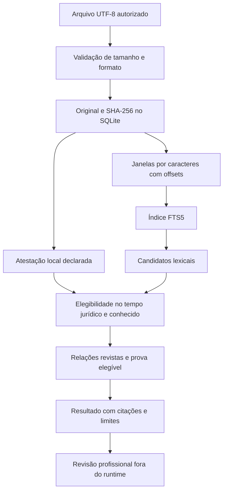

> **Nota da release 0.2.0:** as tabelas desta página descrevem a base 0.1.0. O adendo [ENGINEERING-V02.md](ENGINEERING-V02.md) registra os quatro módulos novos, 39 plugins, 176 workflows e a documentação React Flow.

# Arquitetura brasileira: implementação atual e desenho institucional

## 1. Decisão de escopo

Esta versão entrega dois produtos articulados: um marketplace de workflows e uma ferramenta local de evidências. Não disfarça um catálogo de prompts como plataforma distribuída pronta. A arquitetura institucional abaixo é uma especificação de evolução, distinta das funções já executáveis.

O upstream é marketplace de plugins, não motor brasileiro de jurisprudência. Sua duplicação preserva proveniência e organização; a camada nacional introduz competência, regimes, evidências, temporalidade e estados de revisão. Os adaptadores jurisdicionais dos materiais LexGuard são preservados como orientação, sem importar os motores simulados iniciais.

O núcleo local roda sem GitHub, banco de grafos, API de modelo ou infraestrutura GPU. As calculadoras herdadas usam Pydantic/Decimal; o módulo novo de evidências é biblioteca padrão Python/SQLite. Dependência de uma biblioteca instalável não é dependência de um repositório remoto em tempo de execução.

## 2. Separação das camadas

| Camada | Implementação 0.1.0 | Evolução institucional |
|---|---|---|
| Política e workflows | 38 plugins, 169 skills e política incluída por plugin | Revisão por especialistas, versionamento de release e avaliação semântica |
| Ingestão | Texto UTF-8, bytes originais, hash, offsets e linhas | PDF nativo, OCR isolado, planilhas, tabelas e transformações com proveniência |
| Busca | FTS5/BM25 local e travessia limitada de arestas revistas | PostgreSQL full-text + pgvector, reranking e projeção Neo4j opcional |
| Conhecimento | Atestações temporais declaradas sobre documentos | Assertivas por dispositivo/tese com competência, revisão autenticada e temporalidade |
| Cálculos | Preço de engenharia, BDI e disponibilidade | Outras fórmulas somente após definição jurídica e teste de unidades/fronteiras |
| Orquestração | DAG local e gate herdados | Fila durável, outbox, orçamento por caso e autenticação de operações |
| Ato externo | Ausente | Serviço separado, aprovação autenticada de versão exata e reconciliação |
| Auditoria | Hashes, encadeamento e âncora comparável | KMS, assinaturas, retenção protegida e administração segregada |

Não se atribui implementação às células da terceira coluna.

## 3. Invariantes do domínio

Uma norma ter sido encontrada não demonstra vigência. Uma data de publicação não define todas as datas de eficácia. Um precedente existir não significa que sua tese apoia a conclusão. Uma pontuação do LLM não é prova nem probabilidade calibrada de sucesso judicial.

Toda conclusão futura deve poder ser decomposta em: questão, regime, fato ou alegação, evidência, regra, exceções, subsunção, objeção, resultado e revisor. Atores, território, fase, competência e datas fazem parte da identidade da análise. A mesma proposição pode ter aplicações distintas em casos diferentes.

Estados do requisito: `satisfeito_no_escopo`, `nao_conformidade_evidenciada`, `inconclusivo`, `nao_aplicavel_justificado`, `erro`. A ausência de achado não gera aprovação. Severidade, qualidade da evidência e cobertura são medidas separadas. Média de risco não compensa uma falha crítica.

## 4. Fluxo do runtime realmente implementado

A ingestão é idempotente para conteúdo, origem declarada, título e tipo iguais. Conteúdo alterado gera novo documento; fontes diferentes não são colapsadas por hash global. Isso evita afirmar que identidade binária equivale à mesma origem ou à mesma autorização de uso.

Janelas padrão: 4.000 caracteres, sobreposição de 400, preferência por quebra de linha. São **janelas de texto, não chunks semânticos, tokens de modelo ou parser de artigos**. O texto não é resumido na ingestão; a relação com o original permanece verificável. Linha e offset referem-se ao texto UTF-8 decodificado, não à página de um PDF inexistente.

Os índices de quebra de linha são pré-computados; não se reconta todo prefixo do documento para cada chunk. Uma referência retorna offset e linhas da citação exata. Citações repetidas usam a primeira ocorrência naquele chunk, fato que deve ser considerado ao escolher localizador.

## 5. Temporalidade

Três registros têm funções distintas: `observed_at`, quando a fonte foi observada; `recorded_at`, quando entrou na base; `[valid_from,valid_until)`, período jurídico declarado. Consulta recebe `effective_on` e `known_at`. Não permite que um documento desconhecido no snapshot apareça apenas porque relata fato antigo.

As atestações são acrescentadas. A mais recente até o snapshot pode aceitar ou rejeitar. Norma sem início de eficácia permanece inelegível na busca padrão. Rejeição ou período excluído não é revertido com `--include-unverified`: essa opção permite inspeção do desconhecido, não autoriza ignorar uma invalidade já registrada.

Limite da implementação: a granularidade é documento. Para um diploma com diferentes regimes por artigo, preparar unidades separadas ou implementar a ontologia de assertivas por dispositivo. O runtime não calcula modulação, revogação tácita ou solução de antinomias.

## 6. Grafo e recuperação

Uma aresta exige fonte, destino, relação, trecho de prova e citação literal. Sua existência é proposta; somente revisão explícita a torna elegível à travessia. A prova também precisa estar elegível. Arestas não autenticam identidade do revisor e não certificam que a inferência é correta.

Relações atuais: `references`, `supports`, `contradicts`, `amends`, `revokes`, `interprets`. São etiquetas de assertivas, não operadores jurídicos que modificam automaticamente o estado das normas. A ontologia expandida está em `ontology/br-legal.json`.

A busca abre snapshot SQLite para manter consistência entre filtro e travessia. Usa query FTS formada por termos escapados; operadores fornecidos no texto não se tornam instruções de banco. A seleção é ordenada por ranking lexical e identificador para desempate.

Limites: até 1.000 candidatos examináveis, `limit` de 1 a 100 seeds, `hops` de 0 a 3, `max_nodes` até 1.000 e `max_edges` até 10.000, com padrão de 2.000 arestas. Nós revisitados não expandem ciclos indefinidamente. Aresta examinada consome orçamento mesmo se a prova for inelegível. Truncamento é exibido; não se afirma busca exaustiva.

Consequência: muitos resultados inelegíveis podem esgotar a janela lexical antes de um documento relevante mais distante. Essa perda de recall é conhecida, não alucinação a ser preenchida por LLM. Um serviço institucional deve filtrar tenant/tempo em índices apropriados e medir recuperação antes de aumentar fan-out.

## 7. PostgreSQL, pgvector e Neo4j: desenho de evolução

**PostgreSQL é proposto como autoridade transacional.** Entidades: tenant, matter, source, source_snapshot, document_version, text_segment, normative_instrument, provision_version, authority, jurisdiction, assertion, assertion_evidence, assertion_review, graph_projection_checkpoint, calculation, deliverable_version, approval, audit_event, outbox.

As chaves e FKs de dados privados incluem tenant e matter. Uma FK somente por UUID não demonstra separação de escopo. Deduplicação global de material privado não deve expor existência de documento entre clientes. Dados públicos curados e arquivos privados usam domínios de segurança distintos.

RLS deve ter políticas aplicadas, tenant e matter definidos pelo servidor após autenticação/autorização e sem exposição arbitrária da sessão SQL. O usuário da aplicação não pode ser superuser, dono desprotegido ou possuir BYPASSRLS. `FORCE ROW LEVEL SECURITY` não protege contra superuser; políticas são uma camada, não autenticação. Fonte: https://www.postgresql.org/docs/current/ddl-rowsecurity.html.

**pgvector é índice derivado**, não verdade jurídica. Registrar modelo, versão, dimensão, normalização, parâmetros de chunking, hash de entrada e permissões. Não misturar vetores de modelos diferentes só porque compartilham dimensão. Reindexação ocorre em geração nova, com verificação e troca atômica do ponteiro; não substituir em-place um índice usado para reproduzir análise anterior.

**Neo4j é projeção opcional.** O worker consome outbox idempotente, grava versão de origem e cursor, e não recebe autoridade para tornar uma hipótese aceita. Relações não revistas podem existir em superfície de curadoria separada, nunca no caminho padrão de resposta. Consulta registra o watermark da projeção; resultado atrasado não pode ser apresentado como estado atual do PostgreSQL.

Não distribuir commit entre PostgreSQL e Neo4j com promessa informal de atomicidade. A outbox é gravada na mesma transação da alteração primária; a projeção é eventualmente consistente. Operação que exige dado recém-revisto consulta autoridade primária ou espera critério explícito de atualização com timeout, em vez de inventar resultado. Esses serviços ainda não foram provisionados.

## 8. GraphRAG institucional, sem dependência de framework

Pipeline proposto: autorização → manifesto → extração → reconhecimento de entidades candidato → resolução de identidades → assertivas candidatas → revisão de proveniência → revisão de relação → busca híbrida → expansão limitada → conferência temporal/jurisdicional → pacote de evidências → geração opcional → conferência de citações → revisão profissional.

O runtime atual implementa um subconjunto local: extração de texto recebido, recuperação lexical, arestas declaradas e revistas, filtros temporais e citação. **Não é GraphRAG semântico completo.** Nenhum dos comandos chama modelo de embeddings, extrator neural ou gerador.

A integração futura com modelo deve seguir interface de capacidade e resultado tipado, não SDK inserido em todas as regras. Modelos podem ser trocados sem mudar identidade de evidências, cálculos, tempo, autorização e revisão. Prompts e tokenizer têm versão. A política de dados determina quais modelos podem receber cada classificação de documento.

## 9. Custo, latência e micro-otimizações

A principal otimização é não reenviar a íntegra a cada skill. Extrair uma vez, compartilhar evidência por ID, selecionar módulos aplicáveis e operar por requisito. A independência de 169 workflows não autoriza disparar todos sobre cada chunk.

Planejamento de custo por execução: tokens de entrada e saída por estágio, cache reutilizado medido, número máximo de nós, chamadas externas, tentativas, tempo de CPU, memória e custo de modelo. Retentativa só ocorre dentro do orçamento. Um classificador rápido não pode reduzir o escopo silenciosamente sem registrar o critério.

Não há SLA de TTFT de 35 ms ou documento de 500 páginas em 1,8 s. Nenhum benchmark GPU foi executado. Cache de prefixo pode reduzir trabalho repetido, mas depende do backend, prefixo e isolamento; não é legislação permanentemente residente ou garantia de atualidade. Uma implementação futura deve avaliar p50/p95/p99 com cache frio/quente, concorrência, tamanho real e critério de qualidade.

Cache keys propostas: domínio de confiança, versão do modelo, tokenizer, template, norma/snapshot, classificação de acesso, idioma, permissões e hash canônico da entrada. Conteúdo privado não compartilha prefixo entre tenants por padrão. Cache invalidado precisa marcar as conclusões que dele dependiam, sem destruir reprodução histórica.

## 10. Orquestração e consistência

Começar institucionalmente com monólito modular e workers. Separar processos apenas quando houver necessidade medida de escala, isolamento ou manutenção. Não operar Kafka e RabbitMQ em paralelo por catálogo de tecnologia. Fila escolhida exige semântica de ack, replay, particionamento por caso e DLQ com acesso restrito.

A DAG tem dependências reais: material não extraído bloqueia análise que dele depende; calibração econômica depende de objeto/unidades; minuta depende de achados e prazo conhecido. Revisão adversarial é dirigida às conclusões relevantes, não quatro agentes repetindo documentos completos. Cancelamento deve propagar e liberar recurso; tarefa órfã não é conclusão válida.

O núcleo herdado tem DAG local testada, não scheduler distribuído. Locks Redis/Redlock não substituem transação ou autorização. Operações futuras usam versão esperada, idempotência de negócio e aprovação da versão exata. Resultado externo desconhecido exige reconciliação antes de repetição.

## 11. Falhas catastróficas e comportamento exigido

| Falha | Resposta arquitetural |
|---|---|
| Fonte indisponível | Marcar pendência nas conclusões dependentes; snapshot com data explícita; continuar independentes |
| Retificação altera anexo | Nova versão, invalidar dependências e exigir revisão; não trocar bytes sob o mesmo hash |
| OCR muda negação ou valor | Reduzir confiança do trecho e exigir original; não chamar ausência de anomalia de conformidade |
| Precedente existe mas tese não sustenta conclusão | Rejeitar suporte semântico, sem falsamente declarar precedente inexistente |
| Expansão de grafo vira explosão | Orçamento, ciclos contidos e truncamento visível; não resumir conteúdo jamais recuperado |
| Tenant/contexto de cache errado | Interromper uso, conter incidente e invalidar artefatos afetados |
| Índice perde atualização | Usar watermark; impedir afirmação de atualidade não demonstrada |
| Portal aceita ato e perde resposta | Estado desconhecido, reconciliar recibo; não repetir automaticamente |
| Revisor declara aprovação e documento muda | Aprovação inválida para novo hash; preservar versão anterior |
| Administrador remove cauda de logs | Comparar âncora externa quando existente; cadeia isolada não é prova completa |

## 12. Métricas e critérios de promoção

Cobertura tem denominador: requisitos do caso, documentos esperados e regras aplicáveis. Reportar cobertura documental, normativa, de evidências e de revisão separadamente. Não converter 38 plugins em “100% do Brasil”. Quando o denominador for desconhecido, a cobertura nacional é desconhecida.

Avaliação semântica futura: dataset autorizado com separação por caso, anotação dupla, adjudicação de discordâncias, corpus adversarial, evidência de fontes e versões. Métricas: precisão de citações, suporte da afirmação, recuperação de exceções, aplicação temporal, abstenção adequada, falso negativo crítico e estabilidade. Não estimar acurácia a partir do número de testes unitários.

A primeira promoção institucional exige fluxo vertical completo em escopo delimitado: fonte autorizada real → documento original → localizador → achado revisto → minuta versionada. Autenticação, recuperação de falhas, proteção de dados e restauração devem ser homologadas antes de ampliar a automação.
